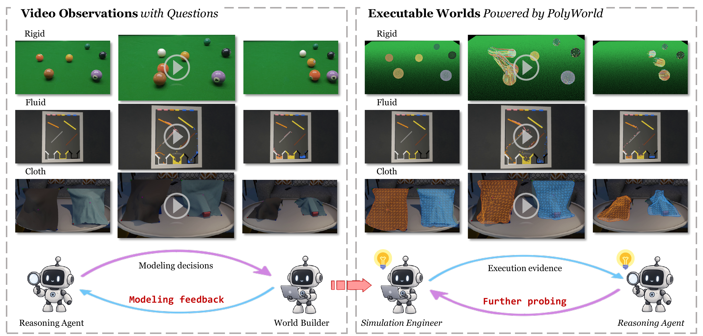
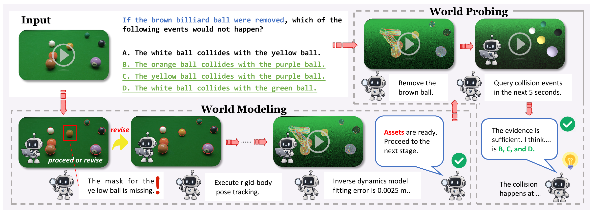

<div align="center">
  <h1>Asking the World</h1>
  <h3>Generalist Physical Reasoning through<br>Agentic World Modeling and Probing</h3>

  <p>
    Shenxiang Zeng<sup>1,*</sup> · Chen Yang<sup>1,*</sup> · Peiyao Chen<sup>1</sup> ·
    Guohui Zhang<sup>1</sup> · Jiansheng Fan<sup>1,†</sup> · Chen Wang<sup>1,†</sup>
  </p>
  <p>
    <sup>1</sup>Tsinghua University<br>
    <sup>*</sup>Equal contribution &nbsp;&nbsp; <sup>†</sup>Corresponding authors
  </p>

  <p>
    <a href="https://asking-the-world.github.io/"></a>
    <a href="https://arxiv.org/pdf/2609.39135"></a>
    <a href="https://arxiv.org/abs/2609.39135"></a>
  </p>
</div>

<p align="center">
  <a href="assets/teaser.png"></a>
</p>

## 🔥 News

- 🎉 **[2026-10-17]** Code and reproduction instructions released.
- 📄 **[2026-09-30]** ATW released on arXiv.

## Overview

**Asking the World (ATW)** is a training-free generalist agent that constructs and interrogates task-relevant executable worlds for physical reasoning through two adaptive stages:

1. **World Modeling** calibrates a world from video.
2. **World Probing** queries, simulates, and intervenes on that world to obtain question-relevant evidence.

ATW determines how to model and probe according to the scene and question, adapting its operations through tool results and execution feedback. **PolyWorld Engine** is a lightweight, highly programmable Warp-based multiphysics simulator supporting rigid bodies, soft bodies, cloth, ropes, fluids, and their coupled interactions.

<p align="center">
  <a href="assets/overview.png"></a>
</p>

## Results

### CLEVRER

Per-question accuracy requires every option in a question to be classified correctly.

| Method | Per-question | Per-option |
|---|---:|---:|
| Gemini-3-Flash (direct) | 34.32 | 64.97 |
| GPT-5.5 (direct) | 67.24 | 83.66 |
| [PhysMind](https://github.com/ccyydd/PhysMind) | 72.55 | 87.22 |
| **ATW (ours)** | **80.82** | **91.28** |

### ContPhy

| Method | Accuracy |
|---|---:|
| Gemini-3-Flash (direct) | 42.46 |
| GPT-5.5 (direct) | 67.03 |
| **ATW (ours)** | **70.56** |

## Installation

Use Linux with an NVIDIA GPU and CUDA. Follow the [installation guide](docs/installation.md) to set up the environments, pretrained weights and OpenRouter API key.

Initialize dependencies from the repository root:

```bash
git submodule update --init --recursive
```

## Data Preparation

We evaluate on **CLEVRER** for rigid-body reasoning and **ContPhy** for cloth, softbody, rope and fluid reasoning.

Prepare the datasets and generate scene requests:

```bash
python scripts/prepare_clevrer.py
python scripts/prepare_contphy.py --variant full
python scripts/prepare_evaluation.py --data-root data --output-dir evaluation
```

Requests are saved in `evaluation/inputs/`, with output paths in `runs.json` and separate scoring labels in `reference.json`. See the [data guide](docs/evaluation.md) for details.

## Quick Start

Run both stages for one scene with the unified entry point:

```bash
# CLEVRER
CUDA_VISIBLE_DEVICES=0 python scripts/run_atw.py \
  --input evaluation/inputs/clevrer_10000.json \
  --output-dir evaluation/runs/clevrer_10000 --device cuda:0

# ContPhy
CUDA_VISIBLE_DEVICES=0 python scripts/run_atw.py \
  --input evaluation/inputs/rope_350.json \
  --output-dir evaluation/runs/rope_350 --device cuda:0
```

Use a new output directory for each run. The default `--stage both` builds assets and answers questions; `--stage stage_one` builds assets only. See the [usage guide](docs/usage.md) for custom inputs and asset reuse.

## Evaluation

Score saved answers without invoking a model:

```bash
python scripts/evaluate.py \
  --reference evaluation/reference.json \
  --runs evaluation/runs.json \
  --output evaluation/scores.json
```

CLEVRER and ContPhy are scored separately, with accuracy, coverage and video-fallback statistics. See the [evaluation guide](docs/evaluation.md) for metrics and batch manifests.

## Debug Visualization

Generate debug views from a completed run with one command. Existing segmentation,
reconstruction/tracking and depth views retain their rendering; fitted SWR scenes
automatically use the refined renderer for their engine.

```bash
CUDA_VISIBLE_DEVICES=0 python scripts/render_debug.py \
  --run-dir /path/to/completed-atw-run \
  --output-dir /path/to/new-debug \
  --blender /path/to/blender --device gpu --workers 4
```

Install `requirements/visualization.txt` in the existing environment and Blender
4.5 for mesh and particle rendering. See [inputs and options](docs/refined-visualization.md).

Rendering can be adjusted for development or presentation needs. It reads saved
assets without changing world models, probing inputs or benchmark evaluation results.

## Citation

If you use ATW, please cite:

```bibtex
@misc{zeng2026askingworld,
  title         = {Asking the World: Generalist Physical Reasoning through Agentic World Modeling and Probing},
  author        = {Shenxiang Zeng and Chen Yang and Peiyao Chen and Guohui Zhang and Jiansheng Fan and Chen Wang},
  year          = {2026},
  eprint        = {2609.39135},
  archivePrefix = {arXiv},
  url           = {https://arxiv.org/abs/2609.39135}
}
```

## Acknowledgements

ATW builds on open-source research tools including SAM 3, SAM 3D Objects, Track4World, FoundationPose, and NVIDIA Warp. We thank their authors and the CLEVRER and ContPhy teams.
